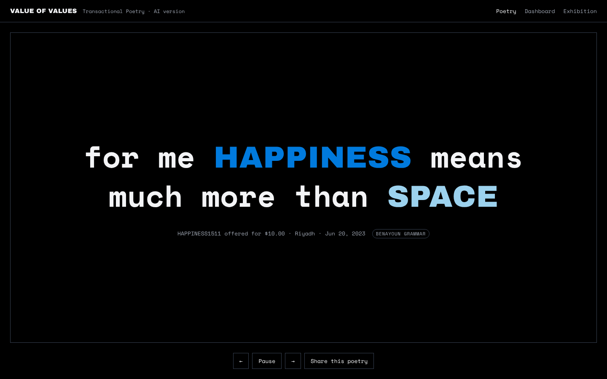

# Transactional Poetry — AI version

An AI version of **Transactional Poetry**, Maurice Benayoun's work within
[Value of Values (VOV)](https://www.v-o-v.io). On VOV, people mint, sell and swap
tokens that embody human values (LOVE, TRUST, FREEDOM…). Transactional Poetry
turns each real transaction into a short poem
([www.v-o-v.io/poetry](https://www.v-o-v.io/poetry),
[www.v-o-v.io/dashboard-one](https://www.v-o-v.io/dashboard-one)).

The original poems fill fixed structures with the traded values. In this version
**Claude writes a new poem for every transaction**. It stays inside the artist's
grammar: the same slot roles, the same voice, and the same typographic rules.
When no AI is available, the original grammar writes the poem instead, so the
piece never goes silent.

| Page | What it shows |
|---|---|
| `/poetry` | One poem at a time, full screen, rotating every 30 s (like `/poetry` on v-o-v.io). `?id=` opens a single poem; ← → and space work. |
| `/clean-poetry` (or `?exhibition`) | Exhibition version: only the poem, no chrome. Esc brings the chrome back. |
| `/dashboard` | Like `dashboard-one`: a rotating poem, totals, the trading history with the poem each trade produced, a **composer** (pick 1–4 values and ask the AI or the grammar), and the median asking price of each value. |



## Run it

```bash
npm install
export ANTHROPIC_API_KEY=sk-ant-...   # optional: without it, only the grammar writes
npm start                             # http://localhost:3000
npm test
```

| Variable | Default | Meaning |
|---|---|---|
| `ANTHROPIC_API_KEY` | – | Turns the AI poet on |
| `POETRY_MODEL` | `claude-opus-5-5` | Claude model that writes the poems |
| `POETRY_EFFORT` | `medium` | `low` / `medium` / `high`: how long the model thinks before writing |
| `AI_BACKFILL` | `30` | How many of the most recent transactions get an AI poem |
| `MAX_AI_POEMS_PER_HOUR` | `60` | Cost guard; after this, the grammar takes over until the hour rolls |
| `POLL_SECONDS` | `60` | How often the VOV market is read |
| `PORT` | `3000` | HTTP port |

AI poems are kept in `data/poems.json`, so each transaction is written once and
not again on every restart. Grammar poems are deterministic: the same transaction
always gets the same poem.

**Static hosting.** `public/` also works on its own (for example on GitHub Pages).
Without the server, the pages read the public VOV API directly and use the
grammar only.

## Exhibition package

```bash
npm run exhibition          # needs ffmpeg; set CHROME_PATH if Chromium is not found
```

This writes `dist/exhibition/` with:
- `player.html`: an offline full-screen player with the fonts embedded;
- two 1920×1080 videos: a seamless loop, and a presentation with title cards;
- stills of every poem;
- `poems.txt`: each trade with its grammar line and its AI line.

The poems come from `exhibition/poems.json`, which `exhibition/write-poems.mjs` builds from a market snapshot.
The 16 AI poems in v0.1.0 were written by Claude during development, with the prompt in `public/js/prompt.js`.
Each one passes the same validator as the live server.

## How a transaction becomes a poem

1. `src/server.js` polls the public VOV API (`/api/v1/chart/trading-history/`,
   `ask-order`, `median-price`, `tokens`) every minute.
2. Each trade (ASK, SOLD or SWAP) gives the poem its **first value**: the token's
   category, e.g. `PEACE0319` → `PEACE`.
3. The poem takes 1 to 4 values in all. The extra values are the distinct values
   traded just before it, so the poem connects the trade to the market flow that
   led to it. The number of values is fixed per transaction (25% one, 50% two,
   20% three, 5% four).
4. The grammar poem appears immediately. Claude is then asked for a new poem
   (`src/poet.js`). Its brief contains the whole grammar, the slot roles, the
   transaction (what happened, and the median price of that value) and the
   values it must use.
5. Before it is shown, the AI poem is **checked**:
   - every value is present, in UPPERCASE;
   - no other word is uppercase;
   - it has at most two lines (`#`) and is short.

   A poem that fails is asked for once more, then the grammar poem stays. A
   refusal falls back the same way; the API's `fallbacks: "default"` re-routing
   is enabled.

### Slot roles (from the sheet)

| Slot | Role | Example |
|---|---|---|
| `AAAAA` → `{A}` | what is given / put on the market | *Give me your {B} and take my **{A}*** |
| `BBBBB` → `{B}` | what is wanted / received | *I gave so much {A} to get some **{B}*** |
| `CCCCC`, `DDDDD` | what the exchange produces, what is cherished above all | *it takes {A}, {B}, and {C} to get pure **{D}*** |

The traded value always appears. When a structure has no `{A}` (for example
*What I really want is your {B}*), its first slot receives the traded value.

### Grammar sources (`public/js/grammar.js`)

- **39 structures from `Poetry_structures.xls`**, kept word for word.
- **55 structures from the live installation.** These are Maurice's later
  revisions and additions, recovered from `api.v-o-v.io/api/v1/tokens/poetry/`
  by turning the poems back into templates.
- **47 values**: the 44 in the sheet (`Friendships` is written `FRIENDSHIP`, as
  on VOV) plus `FAMILY`, `SEX` and `SUCCESS`, which the live market also trades.
  Colours come from `api/v1/chart/vov-colors/`. `AUTHENTICITY`, `CREATIVITY`,
  `DESIRE`, `FINANCE` and `SOCIAL` exist only in the sheet, so their colours were
  chosen here.

Points in the sheet to review with Maurice:

- The `elements` column does not always match the slots it describes (Excel row numbers):
  - rows 10 and 39 (*What I really want is your BBBBB*, *I got your BBBBB…*) say 2 but use only `BBBBB`;
  - row 18 (*I can give all my AAAAA for a bit of CCCCC*) says 3 but uses two slots;
  - rows 19 and 22 (*I cherish CCCCC above all*, *what is important, if not DDDDD?*) say 3 and 4 but use one slot;
  - row 33 (*I love your BBBBB… such a beautiful number!*) says 1 and uses `BBBBB`.

  The engine counts the slots actually present.
- *"can we say AAAAA worths like BBBBB?"* is kept as written. The live version
  reads *"can we say the worth of {A} equals that of {B}?"*.

## Layout

```
src/server.js         market polling, poem store, AI queue, HTTP API + static pages
src/poet.js           Claude prompt, validation, grammar fallback
public/js/grammar.js  structures, values, colours, composition engine (browser + Node)
public/js/market.js   VOV API client, transaction → values
public/js/format.js   "#" line breaks, value highlighting
public/js/prompt.js   what the AI poet is told, and how its answer is checked
public/js/feed.js     page data: server if present, otherwise VOV API + grammar
public/poetry.html    poem page / exhibition version
public/dashboard.html dashboard
docs/                 the original Poetry_structures.xls and screenshots
exhibition/           exhibition player, poems, fonts (OFL) and the video renderer
test/                 grammar tests + AI path against a mock Anthropic API
```

HTTP API: `GET /api/feed?limit=`, `GET /api/poem?id=`, `GET /api/market`,
`POST /api/compose {"values": ["LOVE","MONEY"]}` (one call per visitor every 5 s),
`GET /api/health`.

---

## 中文说明

为 Maurice Benayoun 的 **Transactional Poetry（交易诗）** 制作的 AI 版本。

- VOV 上的每一笔真实交易（挂单、成交、交换）都会生成一首诗。诗由 Claude 撰写，并严格遵守表格里的语法：
  - `AAAAA` 是给出的价值，`BBBBB` 是想得到的价值，`CCCCC` 和 `DDDDD` 是交换的结果；
  - 价值词一律大写，其余单词不能大写；
  - `#` 表示换行，最多两行。
- 没有 API key、超出每小时预算、或 AI 的输出没通过校验时，系统会自动改用原版语法模板生成，作品不会中断。
- 页面：`/poetry`（全屏轮播）、`/clean-poetry`（展览版）、`/dashboard`（交易记录与对应的诗、作诗器、价值中位价）。
- 运行：`npm install`，`ANTHROPIC_API_KEY=... npm start`，然后打开 http://localhost:3000 。
